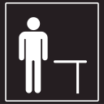

	 
	

<h1 align="center">Standup, pls</h1>
<h3 align="center">Your working timer</h3>

Remind you to stand up and move around.

## About

`Standup, pls` is a Chrome-based web extension that let you set a custom timer to remind you to take an actual break by blocking current browser screen. It also supports sound effect and push notification to your desktop.

## Supported features

| Feature                                          | Status                                       |
| ------------------------------------------------ | -------------------------------------------- |
| Set a custom timer                               | ✅                                           |
| Pause, resume, reset the time                    | ✅                                           |
| Sound effect and push notification to the desktop| ✅                                           |
| When time's up, recommend you some actions to do | ✅                                           |

Something missing? Make an issue and let me know!

## How to install ?

- Download and extract the release.

- Open your extension setting on your browser, enable developer mode, then load unpacked the extracted folder.

- Pin the extension, set the timer, and have a good working time!

## Contributing

Feel free to open pull requests; always welcome contributions! For significant changes, it's best to open an issue first to discuss. Thank you!
